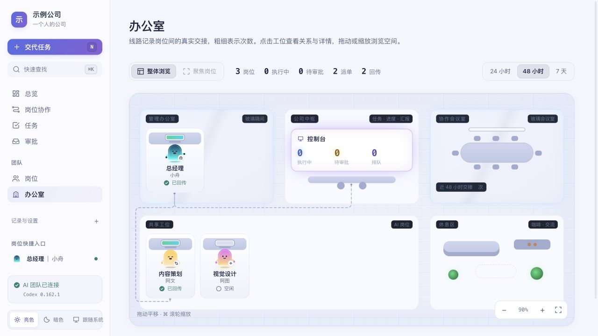
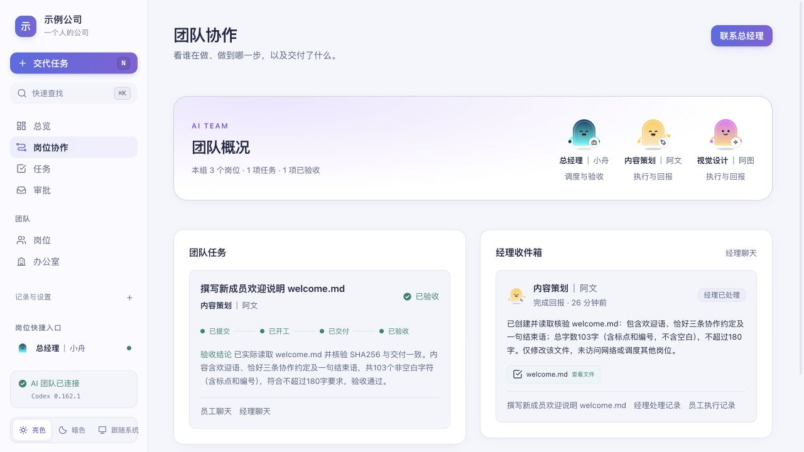
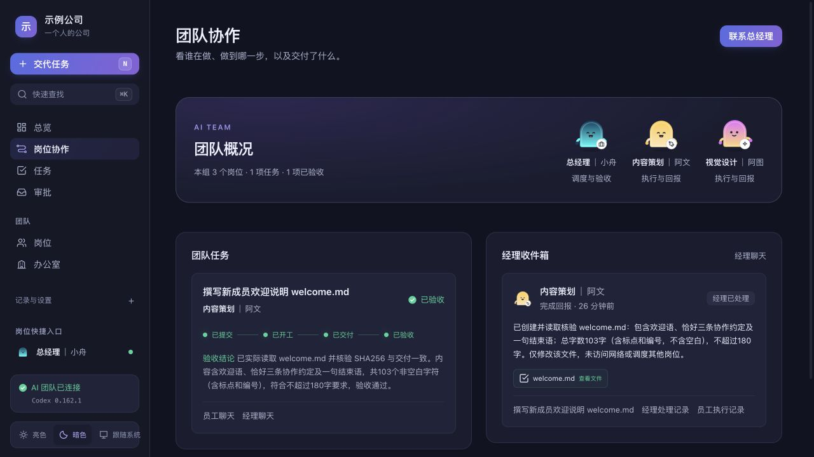
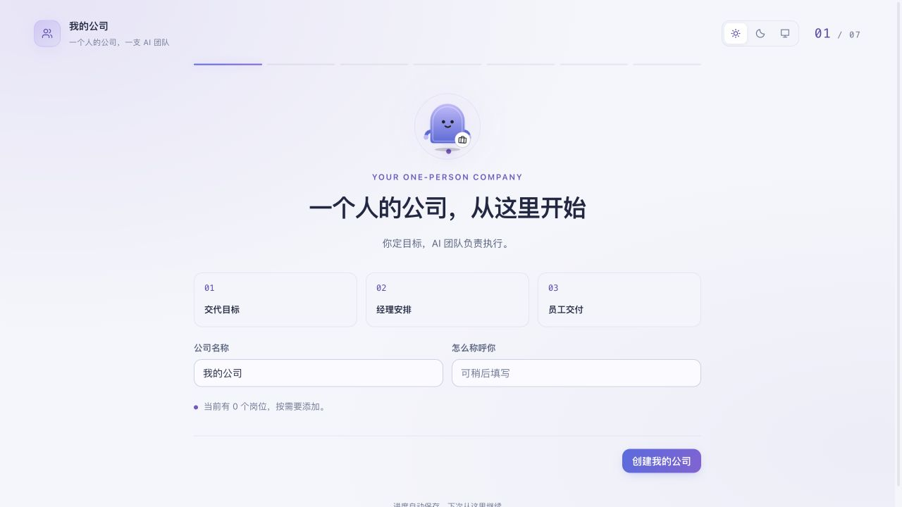
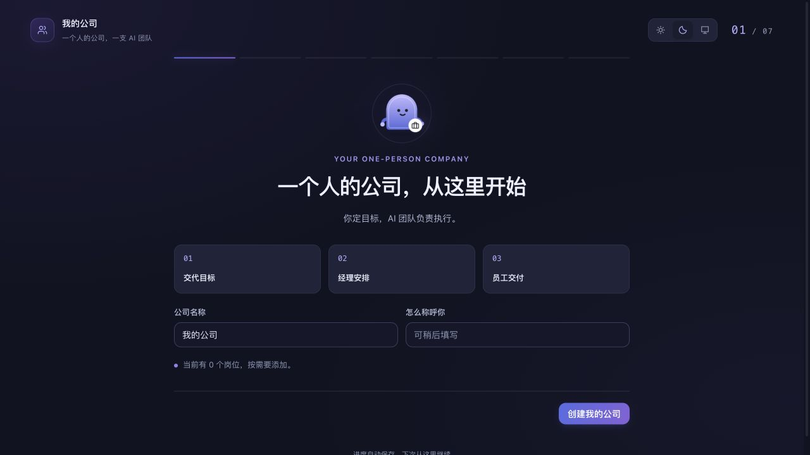

<div align="center">
  
  <h1>一个人的公司</h1>
  <p><strong>一个人，也能运转一家公司。</strong></p>
  <p>你定目标，AI 经理安排，员工执行并交付。<br>把岗位、任务、技能和成果，放在一个清楚的公司里。</p>
  <p><a href="#开始使用">开始使用</a> · <a href="#看看它怎么工作">产品一览</a> · <a href="#一次真实的协作">真实协作</a> · <a href="docs/windows.md">Windows 说明</a></p>
</div>


<p align="center"><sub>独立示例公司的实际界面。新安装从零岗位开始，不会导入截图中的团队。</sub></p>

## 把一个目标，交给一支团队

**你只需要交代目标。** 总经理是统一入口，负责拆分工作、派单和验收；每位员工都有自己的职责与固定会话。

**过程看得见。** 谁收到任务、谁已开工、交付在哪里、经理是否验收，各有记录。办公室用线路展示岗位之间的交接，点击人物就能聚焦关系。

**按需要组建。** 初始没有预置岗位。先命名公司，再建立经理、添加员工，给不同岗位配置 Skill；保留你自己的工作方式。

## 看看它怎么工作



| 清楚地协作 | 白天与夜晚 |
| :---: | :---: |
|  |  |
| 同一个任务串起员工交付与经理验收 | 蓝紫亮色、暗色与跟随系统 |

- **岗位与会话**：岗位优先展示，每位成员保留自己的固定对话；人物会随空闲、执行、等待和交付状态变化。
- **派单与回报**：经理安排工作，员工执行后回传，产物关联原任务；提交、执行、交付和验收分别记录。
- **Skill**：按岗位选择技能，随下一轮任务生效，并区分发现、注入和实际使用记录。
- **执行控制**：独立团队支持追加指令、审批、暂停、停止与明确续办；状态未知时保留记录。
- **交接与用量**：看任务链路、执行事件和实际用量；费用未知时显示未知，不编造节省比例。
- **本机数据**：运行记录和设置留在自己的电脑，更新保留数据，服务默认仅监听本机。

## 一次真实的协作

截图中的欢迎任务由独立示例团队实际完成：

1. 本人交代目标：为新成员写一份不超过 180 字的欢迎说明。
2. 经理向内容策划派单，只允许修改 `welcome.md`。
3. 员工实际写入并检查文件，使用所选回传 Skill 整理结果，再通过内部工具回报。
4. 经理收到回报后读取文件、核对内容和文件摘要，完成验收。

这次交付为 103 个非空白字符。任务页保留执行记录，协作页显示“已验收”并可查看文件。演示内容是为公开截图单独创建的通用内容，来源为真实 Codex App Server 执行。

## 开始使用

需要 **Node.js 20 或以上版本**。程序没有第三方运行依赖，不需要在项目里执行 `npm install`。

选择独立团队时，需要可用并已登录的 Codex CLI；选择桌面聊天时，需要打开并登录 Codex 桌面版。CLI 的安装和登录方法见 [Codex 官方说明](https://developers.openai.com/codex/cli/)。本程序使用你自己的账号与配置，不复制作者的账号。

### Mac

在终端粘贴：

```sh
curl -fsSL --connect-timeout 10 --max-time 60 https://raw.githubusercontent.com/Let-Lee/one-person-company/main/install.sh | bash
```

安装完成后打开本机页面。以后双击 `~/Applications/OnePersonCompany/启动公司.command`；停止时双击同目录的 `停止公司.command`。

<details>
<summary>尚未安装 Node.js？</summary>

可以通过 Homebrew 安装：

```sh
brew install node@24
```

安装器尊重终端代理；终端没有代理时，读取 macOS 当前启用的 HTTPS 代理，仅用于本次下载，不修改系统设置。

</details>

### Windows 预览

在 PowerShell 中粘贴：

```powershell
$installer = Join-Path $env:TEMP 'one-person-company-install.ps1'
Invoke-WebRequest 'https://raw.githubusercontent.com/Let-Lee/one-person-company/main/install.ps1' -UseBasicParsing -OutFile $installer
powershell.exe -NoProfile -ExecutionPolicy Bypass -File $installer
```

默认安装到 `%LOCALAPPDATA%\OnePersonCompany`。以后双击目录中的 `启动公司.cmd`，停止用 `停止公司.cmd`，检查环境用 `检查公司.cmd`。安装不需要管理员权限，不创建目录符号链接；执行策略参数仅作用于这次脚本进程。

Windows 安装、服务与真实 Codex App Server 的检查范围见 [Windows 说明](docs/windows.md)。**Windows 桌面会话双向消息尚未在真实桌面环境验证，当前按预览提供。**

也可 [下载源码 ZIP](https://github.com/Let-Lee/one-person-company/archive/refs/heads/main.zip)，解压后在 Mac 双击 `启动.command`，在 Windows 双击 `启动.cmd`。

### 跟着引导，建立自己的公司

| 亮色引导 | 暗色引导 |
| :---: | :---: |
|  |  |

命名公司，连接 Codex，建立经理和员工，再交代第一个目标。每一步单独显示，进度自动保存；打开页面和建立空会话不会自动执行模型任务。

页面默认在 `http://127.0.0.1:4318/`。端口被占用时会明确提示，不会擅自停止其他公司或程序。

## 选择适合自己的运行方式

| | 独立 AI 团队 | Codex 桌面聊天 |
| --- | --- | --- |
| 适合 | 在这里建立经理和员工，管理完整任务流程 | 沿用已经在 Codex 打开的聊天 |
| 连接 | 引导中建立岗位与固定会话 | 从本机选择聊天，或填写自己的聊天 ID |
| 执行 | 独立 Codex App Server | 你选择的原桌面聊天 |
| 本页能力 | 派单、Skill、审批、暂停续办、交付与验收 | 发送任务到原聊天，接收进度和回复 |
| 工具 | 文件、命令和代码任务，默认没有桌面全部内置工具 | 取决于原聊天的工具、模型与权限 |
| 其他管理 | 本页管理自己的独立团队 | 其他桌面成员、审批和停止续办仍在 Codex 管理 |

桌面模式无需创建独立岗位。只有实际连接到目标聊天的持有端才显示成功；连接检查不会发送任务。详见 [桌面连接](docs/desktop-connection.md)。

## 给岗位配置 Skill

在“岗位”中选择成员，打开技能设置并保存。技能随下一轮任务提供；保存设置本身不会运行任务，也不把“已选择”当作“已使用”。

项目附带 `yewang-runner-handoff` 示例 Skill，用四行说明结果、实际动作、未完成和需要决定的事项。也可使用自己的 Skill。是否实际发现和使用，以任务记录为准。

## 数据、更新与支持范围

更新时重新运行同一安装命令，岗位、任务和设置保存在独立 `data/` 目录。源码直接启动时，数据默认在项目的 `.data/`。备份数据目录即可；不要把数据、账号文件和聊天 ID 提交到公开仓库。

| 平台 | 安装与本机服务 | Codex 桌面聊天 |
| --- | --- | --- |
| macOS | 已实际验证下载、启动、更新与数据保留 | 已在 26.1007.71326 / build 20398 验证真实连接 |
| Windows | 已在 Windows Server 2025 验证 PowerShell 5.1/7 安装、启动、更新与真实 App Server 初始化 | 已适配本机命名管道，真实桌面双向消息待验证 |
| Linux | 未做完整安装验证 | 未验证 |

[Windows 验证记录](docs/windows.md) · [配置与排查](docs/configuration.md) · [自动检查](https://github.com/Let-Lee/one-person-company/actions/workflows/windows.yml)

<details>
<summary>运行、检查与能力说明</summary>

```sh
node scripts/manage.mjs start --open
node scripts/manage.mjs status
node scripts/manage.mjs doctor
node scripts/manage.mjs stop
```

`npm start` 是前台运行方式。双击启动器在后台运行。端口和数据路径可通过配置变量指定，见配置说明。

桌面连接是针对当前安装版本的本机协议适配，不是稳定公开 API。桌面版升级后若协议变化，需要重新适配，不会换成独立会话冒充连接成功。

自动检查使用临时目录与协议替身，不使用作者的数据或触发模型任务；Windows 安装验证额外启动真实 Codex App Server，但不登录账号或发送模型任务。检查通过不等于每个账号、网络或桌面工具都已就绪。

本次 Mac 验证使用 Node.js 24.21.0、Codex CLI 0.162.1。Windows 真实桌面验证缺口会在文档中保留。

</details>

## 开源与致谢

原生 Node.js ES 模块与 HTML/CSS/JavaScript，无第三方运行依赖。源码采用 [MIT License](LICENSE)。岗位人物参考 Paperclip cap-v1 并独立重绘，所用上游许可与图标来源见 [第三方声明](THIRD_PARTY_NOTICES.md)。
