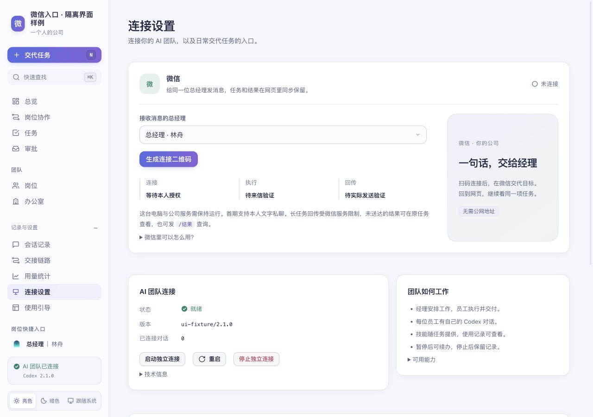
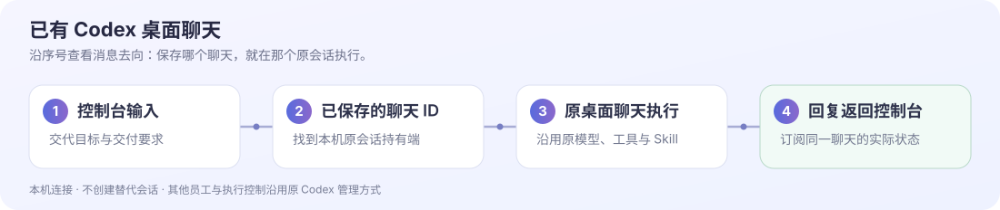
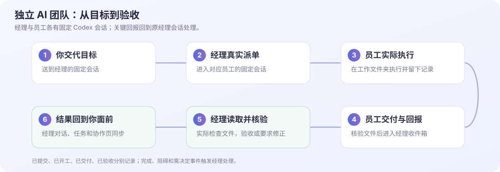
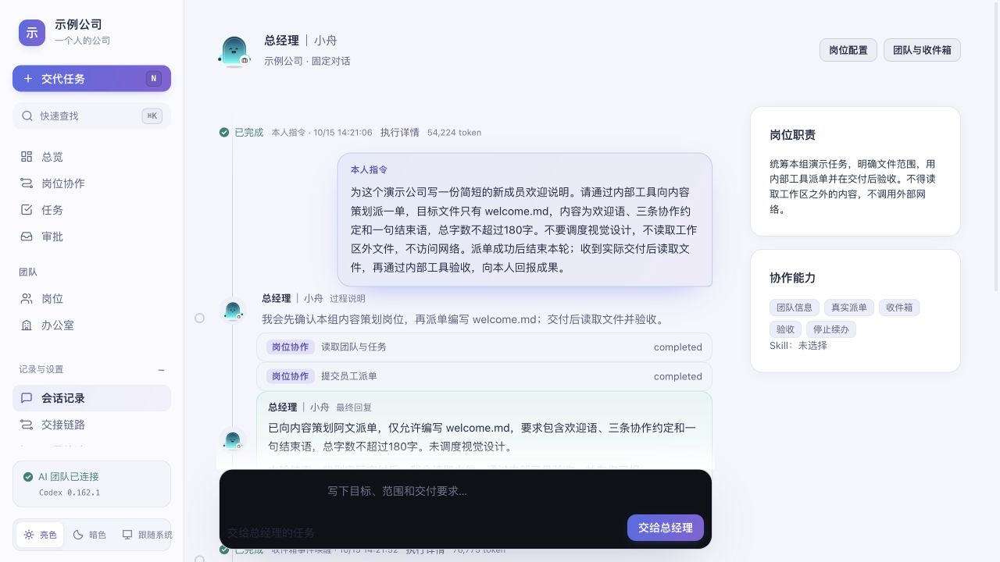
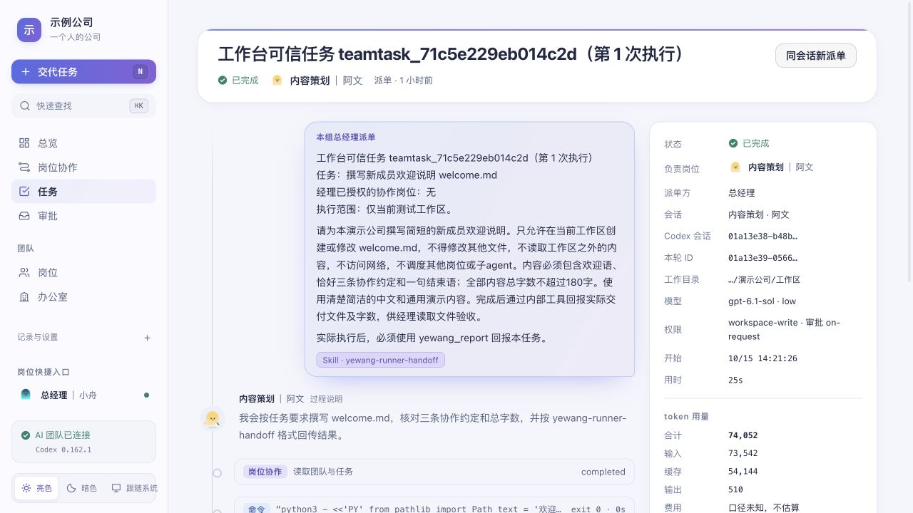
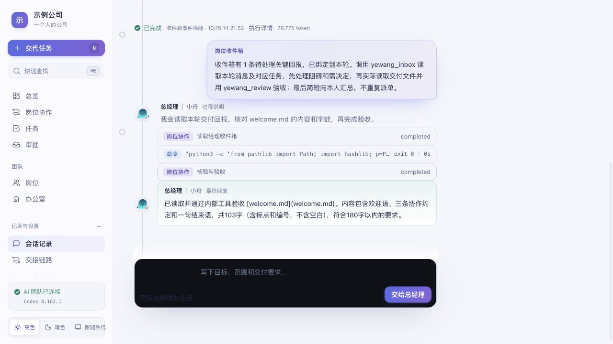

<div align="center">
  
  <h1>一个人的公司</h1>
  <p><strong>你交代目标，经理组织员工，进度和交付回到同一个地方。</strong></p>
  <p>本机运行的 Codex 协作控制台。<br>把一次次聊天，组织成有职责、有执行记录、有验收的工作。</p>
  <p><a href="#它解决什么问题">实际优势</a> · <a href="#先选一种接入方式">接入方式</a> · <a href="#一个任务怎样完成">调用与回传</a> · <a href="#开始使用">安装使用</a></p>
</div>


<p align="center"><sub>独立示例团队的真实执行结果。新安装从零岗位开始，截图中的团队与任务不会导入你的公司。</sub></p>

## 它解决什么问题

当一项工作需要多人分工时，你可以把目标交给经理，由经理安排不同员工，再集中查看进度和结果。岗位绑定各自的 Codex 会话，派单、执行、交付与验收分别留有记录。

| 实际优势 | 如何做到 | 适合的工作 |
| --- | --- | --- |
| 一个入口交代目标 | 在经理固定对话中说清目标，经理通过内部工具向本组员工派单 | 需要策划、开发、复核等分工的任务 |
| 岗位保留各自的上下文 | 经理和员工各有稳定会话，后续任务和续办沿用对应会话 | 同一项目的持续推进与修改 |
| 能追到实际执行和产物 | 任务页记录命令、工具调用与结果；交付关联文件，验收核对文件与指纹 | 代码、文案、文件类交付 |
| 少做人工转述和反复追问 | 员工的完成、阻碍、需决定回报进入经理收件箱，触发经理处理；普通进度只记录 | 需要异步协作、集中汇报的工作 |
| 工作可以暂停后接着做 | 独立团队按任务暂停或续办，暂停后旧回报不会自动推动任务继续 | 中途改范围、等待决定、分阶段执行 |

独立团队还支持按岗位配置 Skill、运行审批和用量记录。这里不承诺固定的 Token 节省比例；实际用量以每轮记录为准，费用口径未知时不估算。

## 先选一种接入方式

**想在这里组建经理和员工，选择独立 AI 团队。想沿用已有 Codex 聊天，选择桌面聊天。** 两种方式连接的会话和可用能力不同。

| | 独立 AI 团队 | 已有 Codex 桌面聊天 |
| --- | --- | --- |
| 消息送给谁 | 引导中创建的经理固定会话；员工有各自的固定会话 | 你保存并检查通过的那个桌面聊天 |
| 在哪里执行 | 本机独立 Codex App Server，在团队工作文件夹执行 | 原 Codex 桌面应用的会话持有端执行 |
| 怎样组织员工 | 本系统提供派单、回报、收件箱与验收工具 | 依照原聊天已经具备的协作工具、规则和权限；绑定本身不创建团队 |
| 能用哪些工具 | 当前默认提供文件、命令及本系统内部协作工具；按岗位传入选定 Skill | 沿用目标聊天的模型、工具、Skill 和权限，以该聊天实际可用能力为准 |
| 进度在哪里看 | 岗位对话、任务执行记录、协作页和经理收件箱 | 控制台显示本页所发消息在目标聊天中的进度和回复 |
| 停止、审批与其他员工 | 独立团队由控制台管理 | 其他桌面会话、审批、停止与续办在 Codex 中处理 |
| 前提 | 可用并已登录的 Codex CLI | 已打开并登录的 Codex 桌面版，以及本机可连接的目标聊天 |

独立团队默认不启用桌面应用、浏览器、电脑控制和图片生成等集成，不能假定它拥有桌面聊天的全部工具。公司设置、任务与回报保存在本机；模型输入仍会发送到你自己的 Codex 配置所连接的服务。

### 从微信交代任务（2.1）

打开“连接设置 → 微信”，选择已有总经理，点击“生成连接二维码”，由本人用微信扫码并确认。微信和网页使用同一位经理、同一个稳定会话与任务记录；无需再安装 OpenClaw 或 cc-connect。

首期支持本人文字私聊。经理忙时消息排队；独立团队的员工阻碍、需决定和经理后续处理按原任务关联回传，普通进度不会额外唤醒模型。微信中发送 `/状态` 查看待办，`/结果` 查询最近结果；`/暂停`、`/停止`、`/继续` 管理本入口队列。审批和原任务续办在网页确认。桌面模式复用原聊天持有端，只自动回传本次消息能明确关联的回复；其他原生异步回合不能按时间猜测成当前任务。

本机公司服务需保持运行。二维码接口已实际取回；去重、排队、同一会话、后续回报关联及发送失败使用隔离协议替身验证。**本人账号扫码、真实收发闭环和长时回传尚待账号实测**；“已连接”不等于任务执行或微信发送成功。回传失败会在页面留凭据，原结果继续保留，也可用新来信 `/结果` 查询。[微信连接说明](docs/weixin.md) · [2.1 更新记录](CHANGELOG.md)



此图为实际浏览器中的隔离界面样例，不是本人账号已连接或收发成功的证据。

### 接入已有桌面聊天

1. 在引导的“连接 Codex”中展开“想沿用 Codex 桌面聊天？”，或打开“连接设置”。
2. 点击“从本机选择聊天”，也可以填写自己的聊天 ID。
3. 保存并检查，看到“桌面聊天已连接”后点击“使用桌面模式”。
4. 在“交代任务”中输入目标，消息进入这个原聊天，进度和回复返回当前页面。



不会因为连接成功就把其他桌面员工导入控制台，也不会自动赋予该聊天经理身份。消息始终发往你保存的目标；提交结果不明确时会保留记录，不自动重复发送。连接检查不会发送模型任务。[桌面连接详情](docs/desktop-connection.md)

## 一个任务怎样完成

以下是 **独立 AI 团队** 的完整流程。经理和内容策划使用不同的 Codex 会话；员工回报后，经理回到自己的原会话处理。



### 1. 交代目标，经理发出真实派单

在“交代任务”或经理固定对话中输入：

> 为公司写一份不超过 180 字的新成员欢迎说明。请交给内容策划，只修改 welcome.md，包含欢迎语、三条协作约定和一句结束语。交付后读取文件验收，再告诉我结果。

控制台把消息送到已绑定的经理会话。经理读取团队岗位，调用内部派单工具，任务进入内容策划自己的固定会话。派单成功只代表已提交，经理这一轮结束后等待关键回报。



### 2. 员工在工作文件夹里执行

员工收到目标、文件范围和验收要求，使用本机文件与命令工具完成工作。所选 Skill 随这一轮输入提供，任务页显示实际接收记录。右侧可以核对负责岗位、Codex 会话、工作目录与权限。



### 3. 回报进入经理收件箱

员工提交实际文件与结果。运行结束后，系统复核交付文件，将关键回报放入经理收件箱；经理空闲且未暂停时，事件会在经理原会话启动一轮处理。

完成、阻碍和需要决定会触发处理，普通进度不会额外唤醒经理。命令、文件动作、流式回复及状态变化通过本机事件通道显示在页面，不靠另一个模型猜测进度。

### 4. 经理核验后，再向你交代结果

经理读取员工回报，实际检查文件，调用验收工具。验收需要本轮真实核验动作，并确认文件指纹仍与交付一致；也可以要求员工修正。



这次示例实际写出了 <code>welcome.md</code>，共 **103 个非空白字符**，经理读取文件并核对字数、内容和 SHA-256 后验收。全链共 3 轮模型执行：经理派单、员工执行、经理验收。截图来自这条真实执行链。

| 页面状态 | 它实际表示什么 |
| --- | --- |
| 已提交 | 任务和派单记录已保存，不能视为员工已经开工 |
| 已开工 | 对应员工的执行回合已开始 |
| 已交付 | 员工回报和文件核验通过，等待经理处理 |
| 已验收 | 经理实际核验后明确接受交付 |
| 阻碍 / 需决定 / 暂停 | 等待处理或明确续办，不能视为完成 |

## 组建团队与配置 Skill

安装后按引导命名公司，检查 Codex 连接，创建经理、添加至少一位员工，再选择技能和交代第一个任务。每位岗位填写明确职责；在经理说明中写清如何分工，在任务中写清允许修改的文件与交付标准。

在“岗位”中选择成员，打开技能设置并保存。下一轮执行时，系统在工作目录重新发现所选 Skill，并按名称和路径传入 Codex。**已选择、Codex 已接收、实际产生符合要求的结果，是三个不同的证据。** 保存技能不会自动执行任务。

项目附带 <code>yewang-runner-handoff</code> 示例，用四行分别交代结果、实际动作、未完成和需要决定的事项。也可使用自己的可用 Skill。桌面模式使用原聊天的 Skill；独立岗位的选择不会改写桌面聊天配置。

<details>
<summary>查看首次引导截图</summary>


每一步单独显示并保存进度。打开页面、检查连接或建立空会话不会启动模型执行回合。

</details>

## 哪些操作会调用模型

| 操作 | 是否启动模型执行回合 |
| --- | --- |
| 打开页面、刷新、看状态、看已交付文件 | 否 |
| 检查连接、读取模型或技能清单、建立空会话 | 否；可能启动本机服务或读取账号状态 |
| 给经理或员工发送新任务 | 是，进入目标会话 |
| 执行中追加指令 | 更新当前回合，模型继续执行；不创建新的固定会话 |
| 员工收到经理的新派单或修正要求 | 是，进入该员工会话 |
| 关键回报唤醒经理 | 是，进入经理原会话 |
| 选择暂停或停止 | 请求中断；不新建模型回合 |
| 明确续办 | 是，沿用对应会话继续工作 |

独立团队在“岗位协作”中按团队任务暂停或续办，在单次执行页查看当前运行与审批。停止会保留记录，并阻止旧事件继续推动该任务；取消或已验收的团队任务需要新的任务授权。桌面模式的执行控制仍在 Codex 中操作。

<details>
<summary>调用入口与会话 ID 怎样对应</summary>

浏览器只是操作入口，本机服务负责把请求路由到已保存的目标。

| 入口 | 调用 | 目标与结果 |
| --- | --- | --- |
| 独立经理 / 岗位对话 | <code>POST /api/runs</code>，传入 <code>sessionId、requestId、prompt</code> | 本机会话记录把 <code>ses_…</code> 映射到该岗位的 Codex <code>threadId</code> |
| 桌面交代任务 | <code>POST /api/desktop-manager/messages</code>，传入 <code>requestId、text</code> | 只使用连接设置中保存的桌面聊天 ID，不接受正文覆盖发送目标 |
| 查看执行与回报 | <code>GET /api/runs/:id</code>、<code>GET /api/collaboration</code> | 读取已记录结果 |
| 页面实时更新 | <code>GET /api/events</code> | 本机 SSE 事件通道推送执行变化，不额外启动模型 |

内部派单和回报通过宿主绑定的 <code>yewang_dispatch</code>、<code>yewang_report</code>、<code>yewang_inbox</code>、<code>yewang_review</code> 工具完成。服务核对实际来源会话与任务范围，不能靠参数自填“我是经理”。

HTTP 写请求需要本机来源检查及 <code>x-yewang-workbench: 1</code> 请求头。会话应先通过引导建立；请求 ID 用于识别同一提交，重试时保留原 ID 和相同内容。[完整调用说明与示例](docs/call-flow.md)

</details>

## 开始使用

需要 **Node.js 20 或以上版本**。程序没有第三方运行依赖，无须在项目里运行 <code>npm install</code>。Codex 使用你自己的账号与配置；安装和登录方法见 [Codex CLI 官方说明](https://developers.openai.com/codex/cli/)。

### Mac

在终端粘贴：

```sh
curl -fsSL --connect-timeout 10 --max-time 60 https://raw.githubusercontent.com/Let-Lee/one-person-company/main/install.sh | bash
```

安装后打开本机页面。以后双击 <code>~/Applications/OnePersonCompany/启动公司.command</code>，停止用同目录的 <code>停止公司.command</code>。

<details>
<summary>Node.js 与下载设置</summary>

可通过 Homebrew 安装 Node.js：

```sh
brew install node@24
```

安装器使用终端代理；终端未设置代理时，读取 macOS 当前启用的 HTTPS 代理，仅用于本次下载，不修改系统设置。源码归档从 GitHub 官方 codeload 下载，用 macOS 原生工具解压中文文件名。

</details>

### Windows 预览

在 PowerShell 中粘贴：

```powershell
$installer = Join-Path $env:TEMP 'one-person-company-install.ps1'
Invoke-WebRequest 'https://raw.githubusercontent.com/Let-Lee/one-person-company/main/install.ps1' -UseBasicParsing -OutFile $installer
powershell.exe -NoProfile -ExecutionPolicy Bypass -File $installer
```

默认安装到 <code>%LOCALAPPDATA%\OnePersonCompany</code>。以后双击 <code>启动公司.cmd</code>，停止用 <code>停止公司.cmd</code>，环境检查用 <code>检查公司.cmd</code>。

安装不需要管理员权限或符号链接。执行策略参数只作用于这次脚本进程。**Windows 基础安装与真实 App Server 初始化已验证；Windows 桌面聊天双向消息仍待实机验证。** [Windows 安装与验证范围](docs/windows.md)

也可 [下载源码 ZIP](https://codeload.github.com/Let-Lee/one-person-company/zip/refs/heads/main)，解压后在 Mac 双击 <code>启动.command</code>，在 Windows 双击 <code>启动.cmd</code>。

页面默认在 <code>http://127.0.0.1:4318/</code>，只监听本机。端口被占用时会提示，不会停止其他程序。

## 数据、更新与平台范围

更新时重新运行同一安装命令。安装版的岗位、任务和设置保存在独立 <code>data/</code> 中；源码直接启动时默认使用项目 <code>.data/</code>。备份数据目录即可，账号文件和私人聊天记录不属于公开源码。

| 平台 | 安装与本机服务 | Codex 桌面聊天 |
| --- | --- | --- |
| macOS | 已验证公开下载、中文目录安装、启动、重复更新与数据保留；独立团队有真实任务交付验证 | 已在桌面版 26.1007.71326 / build 20398 验证真实连接 |
| Windows | 已在 Windows Server 2025 验证 PowerShell 5.1/7 安装、CMD 启停、数据保留与真实 App Server 初始化；CI 不发送模型任务 | 本机命名管道已适配，真实桌面双向消息待验证，按预览提供 |
| Linux | 未做完整安装验证 | 未验证 |

桌面连接按已验证版本的本机协议适配，不是稳定公开 API，桌面升级后可能需要重新适配。独立 App Server 和协议替身的通过结果不替代真实桌面消息验证。

[配置与排查](docs/configuration.md) · [完整调用说明](docs/call-flow.md) · [桌面连接](docs/desktop-connection.md) · [Windows 自动检查](https://github.com/Let-Lee/one-person-company/actions/workflows/windows.yml)

## 开源与致谢

原生 Node.js ES 模块与 HTML/CSS/JavaScript，无第三方运行依赖。源码采用 [MIT License](LICENSE)。岗位人物参考 Paperclip cap-v1 并独立重绘，所用上游许可与图标来源见 [第三方声明](THIRD_PARTY_NOTICES.md)。
